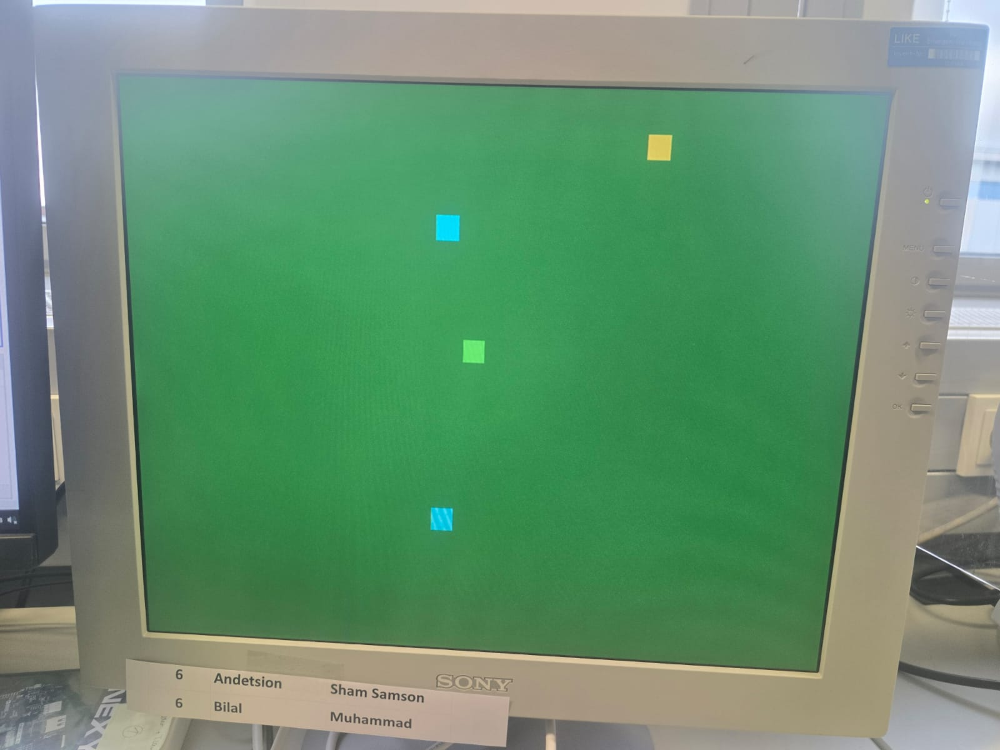
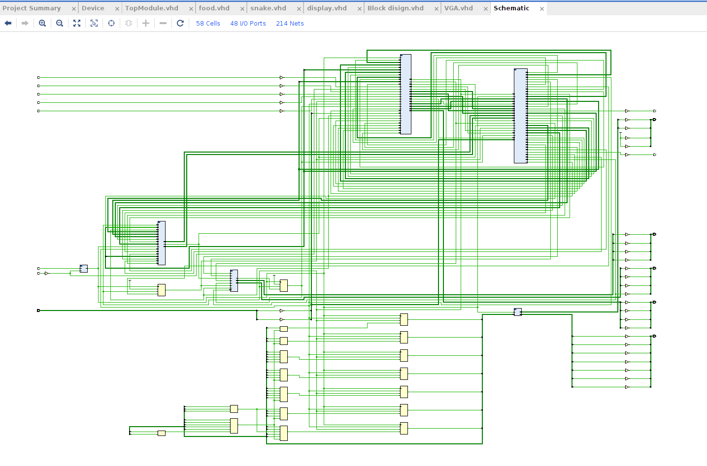
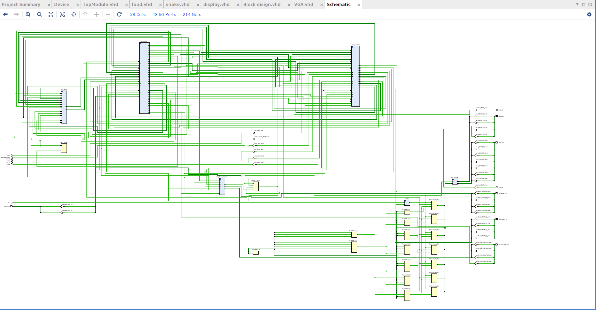
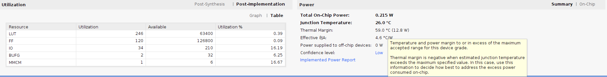
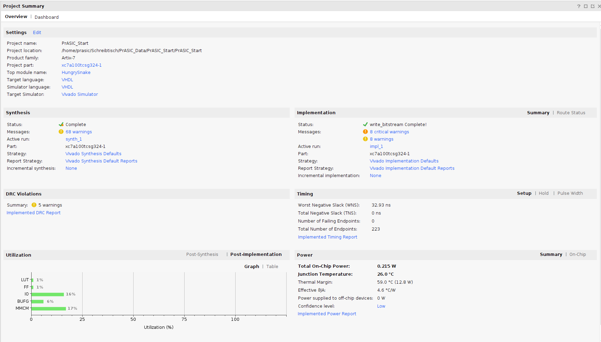
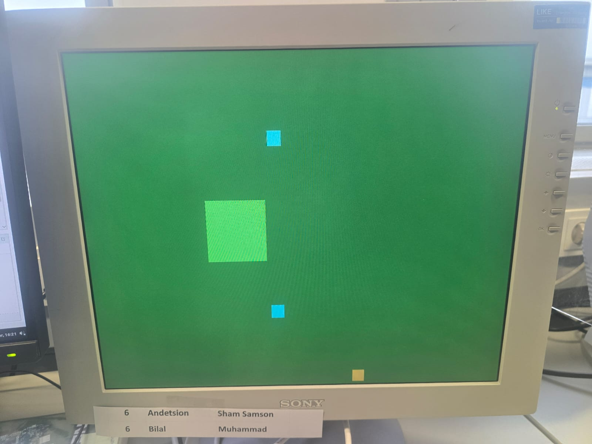

# HungrySnake: Snake game on an FPGA (VHDL)

A Snake-style game written in **VHDL** for the **Digilent Nexys 4** (Xilinx Artix-7) and built in **Xilinx Vivado**. The game draws on a **640×480 VGA display** at 60 Hz, reads the on-board push buttons, and shows the score on the **7-segment display**.



## Features

- 640×480 @ 60 Hz VGA output with 12-bit colour (4 bits per channel), driven by a 25 MHz pixel clock from a Clocking Wizard IP
- Snake steered with the four direction buttons; the centre button restarts the game
- Food placed at pseudo-random positions by a 16-bit LFSR
- The snake grows each time it eats food
- Obstacle blocks; hitting a block or the screen edge ends the game
- Score shown on the 4-digit 7-segment display
- CPU reset button resets the whole design

## Architecture

| Module | File | Role |
|---|---|---|
| `HungrySnake` | `src/TopModule.vhd` | Top level: wires the modules together, mixes the pixel colours, maps the board I/O |
| `clk_wiz_0` | `ip/clk_wiz_0/clk_wiz_0.xci` | Clocking Wizard IP: 100 MHz board clock → 25 MHz pixel clock |
| `VGA` | `src/VGA.vhd` | VGA timing generator: horizontal/vertical counters, Hsync/Vsync, frame-end pulse |
| `snake` | `src/snake.vhd` | Snake position, direction and size; wall and obstacle collision; game-over state |
| `food` | `src/food.vhd` | LFSR-based food placement and food–snake collision detection |
| `Block_design` | `src/Block_design.vhd` | Draws the obstacle blocks |
| `score_display` | `src/display.vhd` | 7-segment score display |
| `pkg_PrASIC` | `src/Package.vhd` | Shared VGA timing constants, 12-bit colour type and colour palette |

`src/drafts/` holds earlier and alternative versions of some modules (other VGA, control and movement variants). They are **not** part of the final build. `Snake_move.vhd` declares the same `snake` entity as `src/snake.vhd`, so don't add both to one project.

## Repository layout

```
src/            VHDL sources (top level + modules)
src/drafts/     Experimental / unused module versions
constraints/    Nexys4 pin constraints (.xdc)
ip/             Clocking Wizard IP configuration (.xci)
docs/           Project report (PDF)
images/         Screenshots, schematics and utilisation reports
```

## Building in Vivado

1. Create a new RTL project for the Nexys 4 board (Artix-7 `xc7a100tcsg324-1`).
2. Add every `.vhd` file in `src/` (not `src/drafts/`) as design sources and set `HungrySnake` as the top module.
3. Add `ip/clk_wiz_0/clk_wiz_0.xci` as an existing IP and let Vivado regenerate its output products.
4. Add `constraints/Nexys4_Master.xdc` as a constraint file.
5. Run synthesis and implementation, generate the bitstream, and program the board. Connect a VGA monitor.

## Controls

| Button | Action |
|---|---|
| BTNU / BTND / BTNL / BTNR | Move up / down / left / right |
| BTNC | Restart the game |
| CPU RESET | Reset the whole design |

## Results

| RTL schematic | Synthesised schematic |
|---|---|
|  |  |

| Resource utilisation | Project summary |
|---|---|
|  |  |



The full write-up is in [docs/HungrySnake_Report.pdf](docs/HungrySnake_Report.pdf).

## Acknowledgements

The top-level skeleton, VGA timing package and board constraints build on the starter template from the PrASIC course at FAU Erlangen-Nürnberg. The `.xdc` file is based on Digilent's Nexys 4 master constraints.
